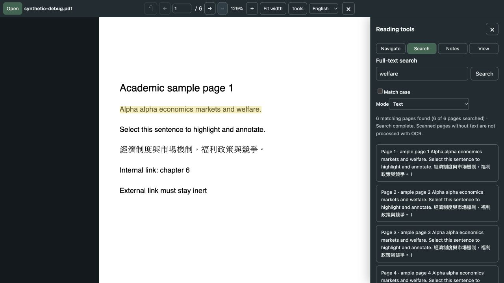

# Jingdu PDF Reader

English | [繁體中文](README.zh-Hant.md)

Jingdu is a PDF reader that sits next to your ChatGPT conversation. In a supported host, opening a PDF automatically shares its extracted text with ChatGPT, so you can read the original while you ask questions. To read locally without sharing, turn **Auto-share** off before opening the file. The app is currently in a trial phase. Its interface defaults to English; choose 繁體中文 from the Language control in the toolbar to switch. The language choice stays only in the current window.

## How to use

1. Open 「PDF 閱讀器」 (PDF Reader) in a ChatGPT conversation where Jingdu is connected. Check **Auto-share text when I open a PDF** before selecting a file. It is on by default; turn it off for local reading.
2. Open a PDF from your device.
3. Wait for **ChatGPT accepted the text**, then ask your question in the conversation. You do not need to prepare a preview or press Send.

Only PDFs opened while auto-sharing is on are shared automatically. Turning it back on applies only to the next PDF you open; it never sends a file opened for local reading. Automatic sharing makes one attempt per file opening and does not retry after failure, rejection, cancellation or uncertain delivery. Turning it off during extraction stops preparation; a message that has started sending cannot be recalled. The setting resets to on in a new reader window.

For a page or selected text, or if an automatic attempt fails, click **ChatGPT** in the toolbar to preview and send manually. If sending is unavailable, copy the preview with Ctrl+C (⌘+C on Mac) and paste it into your conversation. The standalone website cannot send to ChatGPT.

This shares extracted text with the filename and physical PDF page numbers, which may differ from printed page numbers. The original PDF, images, diagrams, and local notes are not attached. Pages without extractable text are marked in the preview. Large documents may need to be shared a page or passage at a time; see the [development notes](docs/development.md#pdf-text-sharing) for limits.

To find passages or check the original, use search, the table of contents, or the two-page and side-by-side views in the reader window. You can also highlight, underline, comment, draw by hand, or capture an area of a page. In the export preview, copy your notes as JSON or Markdown. To continue later, reopen the same PDF and import the JSON.

## Interface preview

Local standalone preview using a synthetic PDF, showing the English interface and search results. No real user documents. This does not demonstrate ChatGPT installation, sidebar pinning, or cross-account verification.

## ChatGPT sidebar entry

The app declares both global-sidebar and conversation-side-panel entries, as described in the [official entrypoint reference](https://developers.openai.com/plugins/build/extensions#sidebar-apps). They require a connected app and a host that supports these extensions. Cloning this repository does not install or automatically pin the plugin. Appearance and automatic pinning have not been verified on another account; public end-to-end MCP access is also unconfirmed. See the [connection notes](docs/development.md#mcp).

## Save before you leave

Annotations stay only in the current window. They are not saved automatically and are not written to the original PDF. Export them before closing or refreshing the page.

## Privacy

Your original PDF is processed in your browser and is not uploaded to this service. In supported ChatGPT hosts, automatic sharing is on by default: opening a PDF sends extracted text, the filename, PDF page numbers and a short standard note to the host, under its policies. Turn it off before opening to read locally. Original PDFs, images, diagrams and local annotations are not included in automatic sharing.

**Send to ChatGPT** manually shares the preview. **Download via ChatGPT** (「交由 ChatGPT 下載」 in Traditional Chinese) separately shares previewed notes or captures, which may include filenames or quoted text. Closing the reader or turning sharing off does not retract content already sent. On the standalone site, sending and host download are disabled; you can copy text or save an image yourself.

The site is hosted on Cloudflare, which may keep standard access logs and set security cookies. During the trial, we recommend using non-sensitive documents.

## Current limitations

- No OCR. Image-only scanned PDFs cannot be searched; scanned PDFs with a text layer can.
- You cannot edit the original PDF, load a PDF from a URL, or sync to the cloud.
- Each PDF must be no larger than 500 MiB and no longer than 5,000 pages. Larger files use more memory.

## More

- [Try the standalone web reader](https://pdf.zhiweiqin.me)
- [ChatGPT connection and development notes (Traditional Chinese)](docs/development.md)
- [License](LICENSE)
- [Third-party licenses (Traditional Chinese)](docs/third-party-licenses.md)
