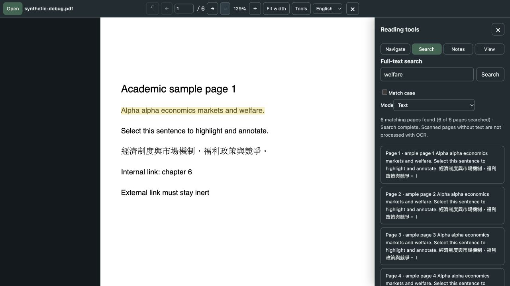

# 靜讀 PDF 閱讀器

[English](README.md) | 繁體中文

靜讀是放在 ChatGPT 對話旁邊的 PDF 閱讀器。在已接入靜讀的 ChatGPT 中開啟閱讀視窗，選一份自己裝置上的 PDF，就能一邊看原文、一邊和 ChatGPT 討論。想問的段落可以連同頁碼貼進對話，請它解釋、比較或整理。目前是試用階段。

本版介面預設英文，可在工具列的 Language 切換為繁體中文；選擇只保留在目前視窗。以下操作以繁中介面為例。

## 怎麼用

1. 在已接入靜讀的 ChatGPT 中開啟「PDF 閱讀器」，選一份裝置上的 PDF。
2. 選取想討論的文字，在「工具 → 搜尋」按「建立頁碼引用」，再按「選取引用文字」。
3. 按 Ctrl+C（Mac 為 ⌘+C）複製，貼到 ChatGPT 對話裡。
4. 接著提問，例如請它解釋這段的意思、和你另外貼入的段落比較，或整理成重點。

需要找段落或對照原文時，可以在閱讀視窗裡搜尋、看目錄，或切換雙頁、雙窗比較。也能標示、加底線、留言、手寫或截取區域。註記可在匯出預覽複製 JSON 或 Markdown，重新開啟同一份 PDF 後再匯入 JSON 接續。

## 介面預覽

本機獨立預覽，使用合成 PDF，呈現英文介面與搜尋結果，未含真實使用者文件；不代表 ChatGPT 安裝、側欄釘選或跨帳號驗證。

## ChatGPT 側邊入口

專案已宣告全域與對話側邊入口，需在支援這些擴充的宿主完成安裝與接入。[官方入口說明](https://developers.openai.com/plugins/build/extensions#sidebar-apps)不代表每個帳號都會自動釘選；下載 GitHub 原始碼也不會自動安裝 plugin。其他帳號的顯示與釘選尚未實測，公開 MCP 端對端也未確認，詳見[接入說明](docs/development.md#mcp)。

## 記得先保存

註記只留在目前視窗，不會自動保存，也不會寫進原 PDF。關閉或重新整理前，請先匯出。

## 隱私

PDF 在你的瀏覽器裡解析，不會傳到本服務。在支援的宿主中，只有你按下「交由 ChatGPT 下載」，才會把預覽的註記或截圖交給宿主。內容可能含檔名或引文，宿主會依自己的規則處理。獨立網站不支援宿主下載，可自行複製文字或另存圖片。

網站由 Cloudflare 託管，可能留下一般存取紀錄和安全 Cookie。試用期間，建議先用不敏感的文件。

## 目前限制

- 沒有 OCR。純影像的掃描檔無法搜尋文字，有文字層的掃描檔可以。
- 不能編輯原 PDF，不能從網址載入，也沒有雲端同步。
- 檔案上限 500 MiB／5,000 頁。檔案越大，越耗記憶體。

## 其他

- [獨立網頁試用](https://jingdu-pdf-reader.qqqqqwz.chatgpt.site)
- [ChatGPT 接入與開發說明](docs/development.md)
- [授權](LICENSE)
- [第三方授權](docs/third-party-licenses.md)
